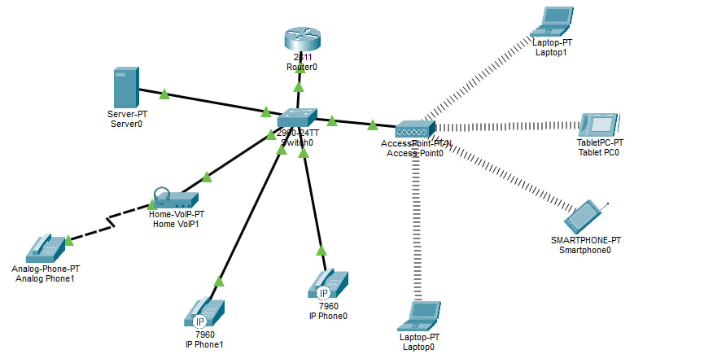

# VoIP & Wireless Network Infrastructure
Cisco Packet Tracer project simulating a network infrastructure with VoIP, wired and wireless connectivity, and network services.

## Project Overview

This project demonstrates the design and simulation of a small office network integrating wired connectivity, wireless devices, IP telephony, and an analog telephone through a VoIP adapter.

The network was designed in Cisco Packet Tracer to explore network infrastructure, device interconnectivity, and the integration of voice and data communication.

## Network Topology

The simulated network includes:

- **Cisco 2811 Router** — network routing
- **Cisco 2960 Switch** — wired device connectivity
- **Cisco Access Point** — wireless network access
- **Cisco IP Phones 7960** — IP telephony endpoints
- **Home VoIP Adapter** — analog telephone connectivity
- **Server** — network services
- **Wireless Clients** — laptops, smartphone, and tablet

### Topology Diagram

## Technologies & Concepts

- TCP/IP Networking
- Cisco IOS
- LAN Infrastructure
- Wireless Networking (WLAN)
- Voice over IP (VoIP)
- Network Topology Design
- Network Simulation
- Network Troubleshooting

## Project Objectives

1. Design a network topology combining wired and wireless devices.
2. Integrate IP telephony into the network infrastructure.
3. Connect an analog telephone using a VoIP adapter.
4. Configure wireless connectivity for mobile devices.
5. Explore communication between network devices.
6. Practice network configuration and troubleshooting.

## Implementation

The network topology was created using Cisco Packet Tracer.

Wireless clients connect through the access point, while IP phones and the analog VoIP adapter are integrated into the wired infrastructure.

## Testing & Verification

The network was tested in Cisco Packet Tracer to verify connectivity and VoIP functionality.

### Test Results

| Test | Result |
|---|---|
| Network device connectivity | ✅ Passed |
| VoIP call establishment | ✅ Passed |
| Voice communication between configured endpoints | ✅ Passed |

### Verification Summary

- Verified successful network connectivity between configured devices.
- Successfully established VoIP calls between configured telephone endpoints.
- Confirmed that the simulated network supports voice communication.

All reported tests were successfully completed in Cisco Packet Tracer.

## How to Run

1. Install Cisco Packet Tracer.
2. Download the `.pkt` file from the `topology/` directory.
3. Open the file in Cisco Packet Tracer.
4. Review the device configurations.
5. Use simulation mode and device CLI tools to inspect network traffic and connectivity.

## Tools

- Cisco Packet Tracer
- Cisco IOS CLI

## Future Improvements

- Implement VLAN segmentation for voice and data traffic.
- Configure Quality of Service (QoS) for VoIP.
- Introduce network redundancy.
- Expand network monitoring and troubleshooting scenarios.

## Author

Vladyslava Prazhmovska | Computer Engineering Graduate
